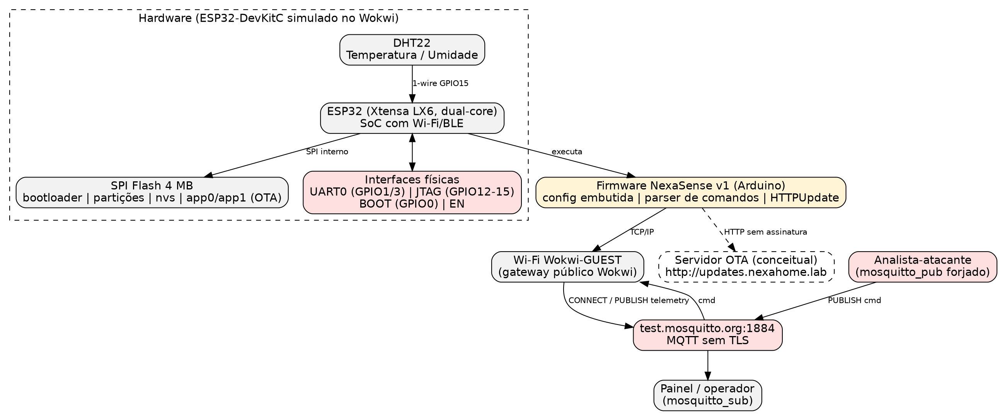

# NexaSense v1 — Avaliação de Segurança IoT

Repositório de evidências da avaliação de segurança do protótipo **NexaSense v1** (ESP32 + DHT22), parte do trabalho "Do Protótipo ao Produto Seguro". Aluno: **Samuel Solano Neres — R.A. 96037**, turma CDC 6NA, UniFECAF.

**Vídeo:** _(preencher com o link não listado do YouTube)_

> **Nota sobre segredos.** Todos os valores sensíveis deste repositório são fictícios ou credenciais públicas do broker de teste `test.mosquitto.org`. Nas evidências, senha MQTT e token aparecem mascarados (`****`). O código-fonte em `firmware-src/` e a imagem bruta `firmware/firmware_original.bin` contêm os valores em claro, por serem o material educacional analisado. Nenhum teste foi feito fora do tópico `nexahome/nx-4b9e21/#`.

## 1. Objetivo

Avaliar a segurança de um protótipo de sensor IoT e propor o caminho até um produto seguro. A avaliação cobre firmware, hardware, comunicação e processo, classifica os riscos e recomenda mitigações ancoradas em referências do setor.

## 2. Dispositivo analisado

NexaSense v1: nó de telemetria ambiental. ESP32-WROOM-32, sensor DHT22 (temperatura e umidade), Wi-Fi, publicando por MQTT. Analisado no simulador **Wokwi web**, com a imagem de firmware preservada.

## 3. Limites e escopo

- Ambiente: simulação (Wokwi web, plano gratuito). Sem bancada física.
- Broker `test.mosquitto.org:1884` usado só como transporte de laboratório.
- Regras de engajamento: publicação e assinatura apenas em `nexahome/nx-4b9e21/#`.
- Fora de escopo: queima de eFuses, fault injection física, dump físico do chip SPI e descompilação no Ghidra. Esses pontos aparecem como análise conceitual, não como execução.

## 4. Arquitetura



Detalhes em [architecture/components.md](architecture/components.md).

## 5. Ferramentas

| Ferramenta | Versão | Uso |
|---|---|---|
| PlatformIO Core | 6.2.0 | Build do firmware e teste nativo |
| esptool | (via PlatformIO) | Consolidação e inspeção da imagem |
| binwalk | sistema | Triagem do binário |
| TShark / Wireshark | 4.2.2 | Análise do PCAP |
| mosquitto-clients | sistema | Observação e demonstração MQTT |
| Graphviz (dot) | 2.43.0 | Diagrama de arquitetura |
| pandoc | 3.1.3 | Markdown → HTML do relatório |
| WeasyPrint | 61.1 | HTML → PDF do relatório |

## 6. Organização das evidências

```
firmware-src/     Código do firmware educacional (fragilidades intencionais) + circuito Wokwi
firmware/         Imagem preservada (SHA-256), evidências estáticas e análise
hardware/         Mapa de interfaces + evidências da UART
network/          Análise de protocolo + PCAP, campos MQTT e demonstração F04
architecture/     Diagrama e inventário de componentes
findings/         Achados F01–F06, matriz de risco e cadeias de ataque
remediation/      Plano de hardening
report/           Relatório em PDF (fonte Markdown + CSS + build)
video/            Roteiro do vídeo
lab/              Scripts de build, mascaramento e análise
```

## 7. Resumo do firmware

Build PlatformIO (arduino-esp32 / ESP-IDF v4.4.7), consolidado em imagem de 4 MB com `esptool merge_bin`, preservado em modo somente leitura.

- **SHA-256:** `39c484e40072e36392ee1c602aa686c028466266dd241b6f955e5e4eb03b3de4`
- Segredos localizados na flash com offset (`firmware/evidence/secret-offsets.txt`).
- Cabeçalho da aplicação sem bloco de assinatura, `Secure version: 0` (`firmware/evidence/image_info.txt`).

Detalhes em [firmware/analysis-notes.md](firmware/analysis-notes.md).

## 8. Resumo do hardware

UART com log verboso e console `config` sem autenticação; JTAG exposto no header; download mode da ROM disponível; flash sem criptografia. Conflito de uso no GPIO15 (DHT22 × JTAG × strapping). Detalhes em [hardware/interface-map.md](hardware/interface-map.md).

## 9. Resumo dos protocolos

MQTT 3.1.1 sobre TCP, porta 1884, sem TLS (`pacotes TLS: 0`). Credencial compartilhada enviada em claro no CONNECT; token embarcado em cada telemetria. Comando remoto sem autenticação de origem nem anti-replay. Detalhes em [network/protocol-analysis.md](network/protocol-analysis.md).

## 10. Principais achados

| ID | Achado | Risco |
|---|---|---|
| F01 | Credenciais e token fixos e compartilhados | Alto |
| F02 | UART verbosa + console sem autenticação | Médio |
| F03 | MQTT sem TLS | Alto |
| F04 | Comando remoto sem autenticação | Alto |
| F05 | OTA por HTTP sem assinatura | Alto |
| F06 | JTAG e UART download mode em produção | Médio |

Matriz de risco e cadeias de ataque em [findings/findings.md](findings/findings.md).

## 11. Recomendações (top 5)

1. MQTT sobre TLS 1.2+ com validação de CA (F03).
2. ACL por aparelho no broker e comando assinado com contador (F04).
3. Credencial única por aparelho em NVS criptografada (F01).
4. Secure Boot v2 + imagem assinada + OTA por HTTPS + anti-rollback (F05).
5. Flash Encryption em release e JTAG desabilitado por eFuse (F02, F06).

Plano completo em [remediation/hardening-plan.md](remediation/hardening-plan.md).

## 12. Reprodução passo a passo

```bash
# 1. Teste do parser de comandos
cd firmware-src && pio test -e native

# 2. Build + preservação da imagem (recusa sobrescrever o original)
lab/build-firmware.sh

# 3. Análise estática (confere o hash antes)
lab/analyze-firmware.sh

# 4. No Wokwi: colar firmware-src/diagram.json, subir firmware/firmware_original.bin (F1)
#    e observar a telemetria:
mosquitto_sub -h test.mosquitto.org -p 1884 -u rw -P readwrite -t 'nexahome/nx-4b9e21/#' -v

# 5. Análise do PCAP exportado do Wokwi
lab/analyze-pcap.sh

# 6. Demonstração controlada F04 (com a simulação rodando)
lab/demo-attack.sh 2>&1 | lab/mask.sh | tee network/evidence/demo-f04.txt
```
