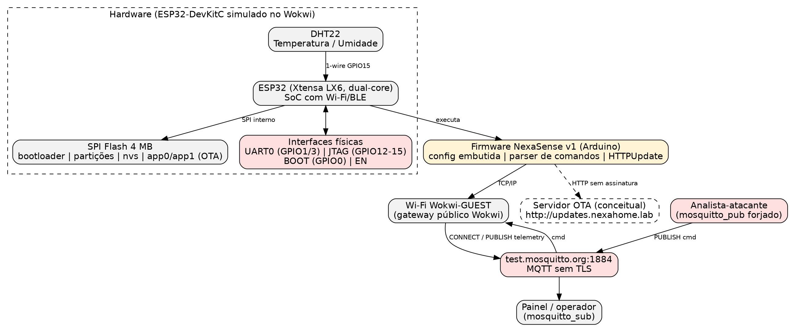

# Componentes — NexaSense v1

## 1. Inventário

| Componente | Identificação | Função | Relevância de segurança |
|---|---|---|---|
| Microcontrolador | ESP32-D0WD (módulo ESP32-WROOM-32 no DevKitC), Xtensa LX6 dual-core, 240 MHz | Executa o firmware, controla o rádio | SoC: CPU, rádio e controlador de flash no mesmo chip. A superfície física se concentra em UART/JTAG e eFuses |
| Memória de programa | SPI Flash 4 MB, interna ao módulo (GPIO6–11) | Bootloader, partições, NVS, app0/app1 | Sem Flash Encryption: um dump expõe tudo (ver `firmware/analysis-notes.md`) |
| Memória de trabalho | 520 KB SRAM | Variáveis, pilha, buffers MQTT | Segredos ficam na RAM e podem ir para a partição `coredump` |
| Memória OTP | eFuses (BLOCK0–3) | Chaves de Secure Boot/Flash Encryption, desabilitar JTAG | Recursos de hardening **não usados** no protótipo |
| Sensor | DHT22 (AM2302) no GPIO15, protocolo 1-wire proprietário | Temperatura e umidade | Integridade da telemetria (Unidade 1.4). GPIO15 também é pino JTAG (MTDO) |
| Comunicação sem fio | Wi-Fi 802.11 b/g/n 2,4 GHz (BLE presente, não usado) | Conexão com o broker | Único canal remoto do dispositivo |
| Interfaces físicas | UART0 (GPIO1 TX / GPIO3 RX via ponte USB-serial), JTAG (GPIO12–15), BOOT (GPIO0), EN | Log, console, gravação, depuração | Ver `hardware/interface-map.md` |
| Alimentação | USB 5 V → regulador LDO 3,3 V | Alimenta SoC e sensor | Lógica de 3,3 V. Ponto de ataque para glitching (Unidade 4.2) |
| Armazenamento | Partições `nvs`, `otadata`, `app0`, `app1`, `spiffs`, `coredump` | Config, OTA A/B, dados | NVS sem criptografia |
| Serviço associado | Broker MQTT `test.mosquitto.org:1884` | Recebe telemetria, entrega comandos | Sem TLS, credencial compartilhada |
| Serviço de atualização | `http://updates.nexahome.lab/nexasense/latest.bin` (conceitual) | Distribuição de firmware | HTTP, sem assinatura |

## 2. Camadas

```
Hardware
   │
   ├── MCU ............ ESP32-D0WD (WROOM-32)
   ├── Memória ........ Flash 4 MB | SRAM 520 KB | eFuses
   ├── Sensores ....... DHT22 (GPIO15)
   └── Interfaces ..... UART0 | JTAG | BOOT/EN | Wi-Fi
          │
          ▼
       Firmware ....... NexaSense v1 (arduino-esp32 / ESP-IDF v4.4.7)
          │             config embutida, parser de comandos, HTTPUpdate
          ▼
       Protocolos ..... Wi-Fi (Wokwi-GUEST) → TCP → MQTT 3.1.1 (1884, sem TLS)
          │             HTTP (OTA)
          ▼
     Serviço associado  broker test.mosquitto.org → painel do operador
                        servidor OTA (conceitual)
```

## 3. Diagrama



Fonte: `architecture.dot` (`dot -Tpng -Gdpi=150 architecture.dot -o architecture-diagram.png`).
