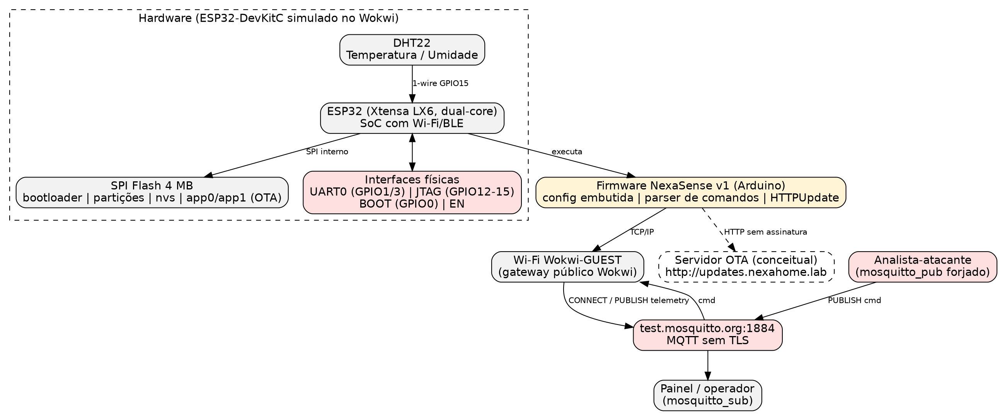
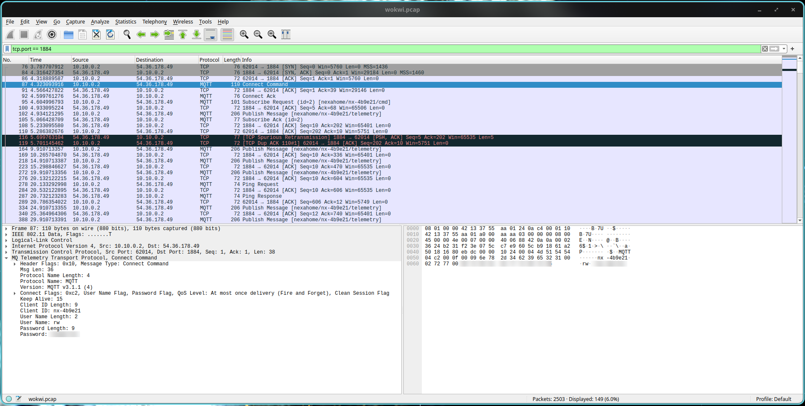
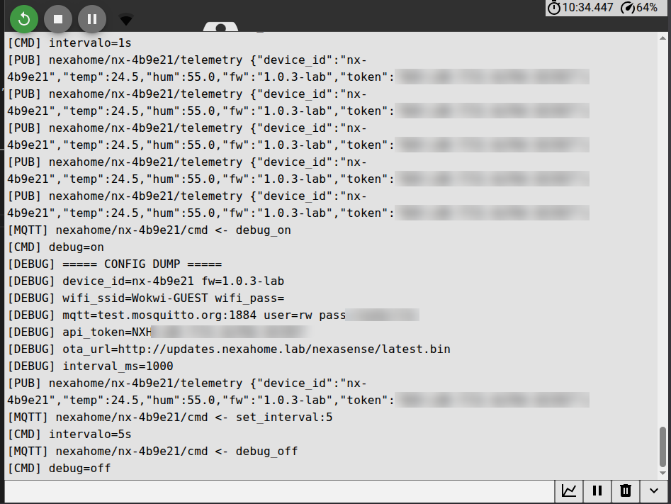

UniFECAF

CIÊNCIA DA COMPUTAÇÃO

Hardware Hacking (IoT)

NexaSense — Avaliação de Segurança IoT

Do Protótipo ao Produto Seguro

Turma:

CDC 6NA

Aluno / R.A.:

Samuel Solano Neres / 96037

Taboão da Serra, SP

# 1. Contexto e Escopo

Este relatório avalia a segurança do protótipo NexaSense v1, um sensor IoT de temperatura e umidade baseado em ESP32. O objetivo é mostrar o caminho do protótipo ao produto seguro: identificar fragilidades, classificar o risco e propor correções.

| Item | Descrição |
|---|---|
| Contratante | NexaHome Technologies (fictícia) |
| Contratada | Samuel Solano Neres — IoT Security Analyst |
| Data | 20/11/2026 |
| Dispositivo | NexaSense v1 (ESP32-WROOM-32 + DHT22) |
| Ambiente | Simulador Wokwi web (plano gratuito) |

## 1.1 Objetivo

Avaliar firmware, hardware, comunicação e processo do protótipo. Entregar uma lista de achados classificada por risco e uma proposta de hardening ancorada em referências do setor.

## 1.2 Escopo e regras de engajamento

A análise ocorreu em simulação. O broker público `test.mosquitto.org:1884` serviu só de transporte de laboratório. Toda publicação e assinatura ficou restrita ao tópico `nexahome/nx-4b9e21/#`. Nenhum sistema de terceiros foi alvo.

## 1.3 Limitações

Ambiente simulado, sem bancada física. Ficaram fora de escopo: queima de eFuses, fault injection física, dump físico do chip SPI e descompilação. Esses pontos aparecem como análise conceitual.

# 2. Descrição do Dispositivo

O NexaSense v1 é um nó de telemetria ambiental. Lê temperatura e umidade de um DHT22 e publica por MQTT via Wi-Fi.

| Componente | Identificação | Função | Relevância de segurança |
|---|---|---|---|
| Microcontrolador | ESP32-D0WD (WROOM-32), Xtensa LX6 dual-core | Executa o firmware, controla o rádio | CPU, rádio e flash no mesmo SoC |
| Memória de programa | SPI Flash 4 MB | Bootloader, partições, app0/app1 | Sem Flash Encryption: dump expõe tudo |
| Memória OTP | eFuses | Chaves de Secure Boot/Flash Encryption | Recursos de hardening não usados |
| Sensor | DHT22 no GPIO15 | Temperatura e umidade | GPIO15 também é pino JTAG |
| Comunicação | Wi-Fi 802.11 b/g/n | Conexão com o broker | Único canal remoto |
| Interfaces físicas | UART0, JTAG, BOOT, EN | Log, console, gravação, depuração | Superfície física |
| Serviço | Broker MQTT `test.mosquitto.org:1884` | Telemetria e comandos | Sem TLS, credencial compartilhada |

# 3. Arquitetura

O fluxo vai do sensor ao broker: DHT22 → ESP32 → firmware → Wi-Fi → MQTT. O servidor de OTA é conceitual. Os blocos em destaque (interfaces físicas, broker sem TLS, atacante) concentram a superfície de risco.

# 4. Mapa da Superfície de Ataque

| Superfície | Ponto de entrada | Pré-condição do atacante | Achados |
|---|---|---|---|
| Físico / UART | Log e console serial | Acesso físico | F02 |
| Físico / JTAG | Header de depuração | Acesso físico | F06 |
| Firmware / Flash | Download mode, dump | Acesso físico | F01, F02, F06 |
| Atualização | OTA por HTTP | Posição de rede ou canal de comando | F05 |
| Rede / MQTT | Tráfego sem TLS | Observação da rede | F01, F03 |
| Serviço / Broker | Tópico de comando | Credencial da frota | F04 |

# 5. Metodologia

A avaliação seguiu uma sequência de fases: reconhecimento, análise estática do firmware, análise de hardware, análise de comunicação, demonstração controlada, classificação de risco e recomendações. A OWASP ISTG serviu de guia para os casos de teste. As ferramentas estão listadas no repositório (PlatformIO, esptool, binwalk, TShark, mosquitto-clients, Graphviz, pandoc, WeasyPrint).

O firmware foi preservado antes da análise: a imagem de 4 MB teve o SHA-256 registrado e todo trabalho ocorreu sobre cópia, com conferência de integridade a cada execução.

# 6. Análise do Firmware

A imagem foi consolidada com `esptool merge_bin` e preservada em modo somente leitura.

- **SHA-256:** `39c484e40072e36392ee1c602aa686c028466266dd241b6f955e5e4eb03b3de4`
- **Tamanho:** 4.194.304 bytes.

A tabela de partições mostra o esquema A/B de OTA (`app0`, `app1`, `otadata`). O cabeçalho da aplicação não tem bloco de assinatura e traz `Secure version: 0`: qualquer imagem com hash correto é aceita, sem prova de autenticidade. A partição `coredump` pode guardar RAM com segredos.

As strings expõem SSID, usuário e senha MQTT, token de API e URL de OTA em HTTP. Os offsets de cada segredo estão em `firmware/evidence/secret-offsets.txt`, com os valores mascarados. A confirmação de que a credencial é usada vem da análise de rede (Seção 8).

# 7. Análise das Interfaces Físicas

A UART0 permanece acessível, fornece o log completo de boot e um console de manutenção, e não possui autenticação nem filtro de dados sensíveis. Com acesso físico, isso permite ler credenciais e token no boot, repetir o despejo com o comando `config` e, pelo download mode da ROM, extrair a flash inteira.

O JTAG está exposto no header, sem eFuse de bloqueio: permite depuração on-chip e leitura/escrita de memória. Há um conflito de projeto no GPIO15, usado ao mesmo tempo para o sensor, para o TDO do JTAG e como pino de strapping.

Interface aberta por si só é superfície, não vulnerabilidade. A UART vira achado por três fatos somados: imprime segredo, não barra o operador e não protege o conteúdo da flash.

# 8. Análise das Comunicações

O tráfego capturado mostra: resolução de `test.mosquitto.org`, conexão TCP na porta 1884, CONNECT com usuário e senha em claro, SUBSCRIBE em `.../cmd` e PUBLISH periódicos em `.../telemetry`. A captura registrou **zero** pacotes TLS.

| Item | Observado | Avaliação |
|---|---|---|
| Protocolo | MQTT 3.1.1 sobre TCP | Sem segurança por si só |
| Autenticação | usuário e senha compartilhados, em claro | Captura expõe a credencial |
| Criptografia | nenhuma (TLS: 0) | Tráfego legível em trânsito |
| Dado | temperatura, umidade e token | Token não deveria ir na telemetria |
| Controle | `.../cmd` sem autenticação de origem | Comando forjado é aceito |

Identificar o protocolo não é o mesmo que uso seguro. Falta TLS, credencial por aparelho, ACL por tópico e assinatura com contador no comando. Sem contador, o comando é vulnerável a replay; sem autorização por tópico, a spoofing.

# 9. Demonstração Controlada (F04)

Para confirmar o impacto, um comando forjado foi publicado em `nexahome/nx-4b9e21/cmd`, usando só a credencial extraída do firmware.

- `set_interval:1` fez a telemetria passar de 5 s para 1 s.
- `debug_on` ligou o modo debug remotamente e provocou novo despejo de configuração.
- `set_interval:5` e `debug_off` restauraram o estado, mantendo o laboratório limpo.

A demonstração é controlada: atua só no tópico do aparelho de laboratório, com credenciais públicas de teste, e restaura o estado ao final. O registro está em `network/evidence/demo-f04.txt` e `demo-f04-serial.png`, com os segredos mascarados.

# 10. Riscos Identificados

Risco = Probabilidade × Impacto, por uma matriz 3×3.

| Prob. \\ Impacto | Baixo | Médio | Alto |
|---|---|---|---|
| **Alta** | Médio | Alto | Alto |
| **Média** | Baixo | Médio | Alto |
| **Baixa** | Baixo | Baixo | Médio |

| ID | Achado | Evidência | Impacto | Prob. | Risco | Recomendação |
|---|---|---|---|---|---|---|
| F01 | Credenciais e token fixos | `strings-interesting.txt` | Alto | Média | **Alto** | Credencial única por aparelho em NVS criptografada |
| F02 | UART verbosa + console aberto | `boot-log.txt` | Médio | Média | **Médio** | Log mínimo; console removido/autenticado |
| F03 | MQTT sem TLS | `mqtt-fields.txt` | Alto | Alta | **Alto** | MQTT sobre TLS 1.2+ (8883) |
| F04 | Comando sem autenticação | `demo-f04.txt` | Alto | Alta | **Alto** | ACL + comando assinado com contador |
| F05 | OTA HTTP sem assinatura | `main.cpp:runOta` | Alto | Média | **Alto** | Secure Boot v2 + HTTPS + anti-rollback |
| F06 | JTAG/UART download mode | `interface-map.md` | Alto | Baixa | **Médio** | Flash Encryption + JTAG por eFuse |

Os achados se encadeiam. Ler o segredo pela UART (F02) ou pela flash (F06) explora a credencial única da frota (F01) para ler dados (F03) e enviar comando a qualquer aparelho (F04). Observar a rede (F03) somado a um `ota:` forjado (F04) leva a instalar firmware malicioso (F05).

# 11. Relação com Referências

| Achado | OWASP ISTG | NIST IR 8259A | ETSI EN 303 645 | MITRE EMB3D |
|---|---|---|---|---|
| F01 | Firmware | Device Identification | §5.1, §5.4 | TID-328 |
| F02 | Physical Interfaces | Logical Access to Interfaces | §5.6 | TID-115 |
| F03 | Comms | Data Protection | §5.5 | TID-408 |
| F04 | Comms | Logical Access to Interfaces | §5.5 | TID-406, TID-407 |
| F05 | Firmware | Software Update | §5.3, §5.7 | TID-211, TID-215 |
| F06 | Physical Interfaces | Logical Access to Interfaces | §5.6 | TID-119, TID-115 |

# 12. Recomendações e Proposta de Hardening

Prioridade antes do piloto (P1): F04, F03 e F01. Antes do lançamento (P2): F05 e F02. Na linha de produção (P3): F06 e processo.

| Camada | Medida (proposta, não executada) |
|---|---|
| Comunicação | `WiFiClientSecure` + CA fixada, porta 8883; ACL por aparelho no broker |
| Identidade | Certificado X.509 único por aparelho em NVS criptografada |
| Comandos | HMAC-SHA256 + contador monotônico; faixa válida de parâmetros |
| Atualização | Secure Boot v2, imagem assinada, OTA por HTTPS, anti-rollback |
| Armazenamento | Flash Encryption em release (autenticidade + confidencialidade) |
| Interfaces | JTAG por eFuse, download mode seguro, log mínimo, console removido |

Secure Boot garante autenticidade; Flash Encryption garante confidencialidade. São complementares: o produto precisa dos dois. O plano completo e a matriz de rastreabilidade estão em `remediation/hardening-plan.md`.

# 13. Caso Real Pesquisado

**CVE-2019-17391 — Fault injection no ESP32.**

- **Dispositivo:** chips ESP32 (ESP32-D0WD e correlatos), reportado por LimitedResults e divulgado pela Espressif em novembro de 2019.
- **Superfície:** alimentação, no instante após o reset (física).
- **Problema:** falta de proteção anti-glitch no bootloader de primeiro estágio. Um glitch na tensão expõe eFuses protegidos, incluindo as chaves de Flash Encryption e Secure Boot.
- **Mitigação:** a revisão de silício ECO3 (ESP32-D0WD-V3) adiciona checagens na ROM. Para silício antigo não há correção por software; a orientação é usar chaves únicas por aparelho.
- **Lição para a NexaHome:** segurança de hardware exige escolher o silício certo (ECO3 ou ESP32-S3) e nunca depender de uma chave compartilhada. Reforça a recomendação de credencial única por aparelho (F01) e de resiliência contra fault injection.

# 14. Conclusão

O NexaSense v1 funciona, mas não está pronto para produção. Seis achados foram identificados, quatro deles de risco Alto, exploráveis só com acesso à rede. A demonstração controlada confirmou o controle remoto do aparelho a partir de uma credencial embutida no firmware.

O caminho até o produto seguro é claro e conhecido: TLS, credencial por aparelho, comandos assinados, Secure Boot com Flash Encryption e atualização assinada. As medidas estão priorizadas no plano de hardening. Recomenda-se o reteste antes do piloto.

- **Repositório de evidências:** https://github.com/Samuel-S-N/iot
- **Vídeo:** _(preencher com o link não listado do YouTube)_

# 15. Fontes Primárias

1. MITRE. *EMB3D Threat Model*. 2024. https://emb3d.mitre.org/threats/ (acesso em 20/11/2026)
2. NIST. *IR 8259A — IoT Device Cybersecurity Capability Core Baseline*. 2020. https://csrc.nist.gov/pubs/ir/8259/a/final (acesso em 20/11/2026)
3. ETSI. *EN 303 645 — Cyber Security for Consumer Internet of Things*. 2024. https://www.etsi.org/deliver/etsi_en/303600_303699/303645/03.01.03_60/en_303645v030103p.pdf (acesso em 20/11/2026)
4. Espressif. *ESP-IDF Programming Guide — Security*. https://docs.espressif.com/projects/esp-idf/en/stable/esp32/security/security.html (acesso em 20/11/2026)
5. NVD. *CVE-2019-17391*. 2019. https://nvd.nist.gov/vuln/detail/CVE-2019-17391 (acesso em 20/11/2026)
6. OASIS. *MQTT Version 3.1.1*. 2014. https://docs.oasis-open.org/mqtt/mqtt/v3.1.1/os/mqtt-v3.1.1-os.html (acesso em 20/11/2026)
7. Espressif. *ESP32-WROOM-32 Datasheet*. https://www.espressif.com/sites/default/files/documentation/esp32-wroom-32_datasheet_en.pdf (acesso em 20/11/2026)
